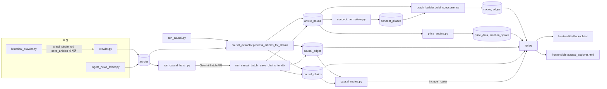
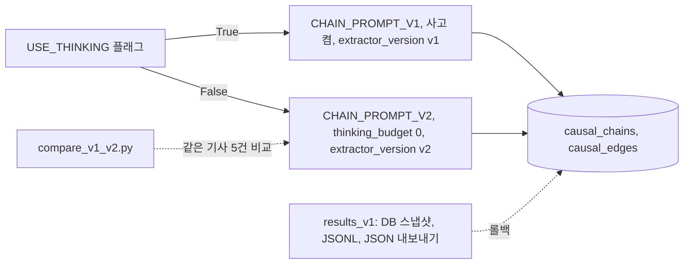

# macro-graph

A web app that collects Korean economic news, extracts cause-and-effect chains with Gemini, and lets you explore what a given event (a war, a rate hike) propagates to.

한국 경제 뉴스에서 Gemini 로 인과 체인을 뽑아 SQLite 에 쌓고, "전쟁이 나면 유가와 금리와 공급망은 어떻게 연결되나"를 FastAPI 와 D3.js 화면으로 탐색하는 웹앱이다.

## 무엇을 왜 만들었나

뉴스에는 "후티 공격, 홍해 통행 차질, 유가 상승, 인플레 우려" 같은 연쇄가 기사마다 흩어져 있다. 이 프로젝트의 목표는 그런 연쇄를 사람이 일일이 정리하지 않고 기사에서 자동으로 모아, 사건 하나를 입력하면 그 사건이 어디로 번지는지 순방향과 역방향으로 보여 주는 것이다.

구현은 네 부분으로 나뉜다. 기사를 모으는 수집기, 기사 한 건에서 인과 체인을 뽑는 Gemini 추출기, 체인을 쌓아 두는 SQLite 저장소와 조회 API, 그리고 결과를 보여 주는 정적 HTML 두 장이다. 저장소에는 2026-03-17 까지 모은 데이터가 든 DB 스냅샷(`backend/macro_graph.db`)이 함께 들어 있어서, 키 없이도 조회 화면과 API 를 확인할 수 있다.

처음 설계는 지금과 달랐다. 형태소 분석으로 명사를 뽑아 공동출현 그래프를 만드는 방식에서 출발해, Gemini 가 기사를 읽고 개념을 뽑는 방식을 거쳐, 인과 체인을 직접 뽑는 방식으로 바뀌었다. 그 과정과 아직 풀지 못한 문제는 "배운 점과 한계"에 적었다.

## 핵심 구조

아래 그림은 코드의 실제 호출 관계와 DB 테이블 읽기 쓰기 방향이다.



공동출현 그래프(`nodes`, `edges`)는 `graph_builder.py` 의 필터를 통과한 소수의 노드만 담는다. 인과 체인과 인과 엣지(`causal_chains`, `causal_edges`)는 그 필터를 거치지 않고 `causal_routes.py` 가 직접 조회한다. 인과 탐색기가 따로 생긴 이유가 이 분리다.

## 주요 기능

### 수집

`crawler.py` 는 RSS 피드 22개와 목록 페이지 4곳을 돌고, `backend/urls.txt` 에 적은 URL 도 받는다. 사이트별 CSS 셀렉터는 `DOMAIN_SELECTORS` 에 모여 있고, 본문에서 공유 버튼과 구독 안내 같은 요소를 지우는 `_strip_noise_elements` 가 크롤링 직후에 돈다. `articles.url` 의 UNIQUE 제약으로 같은 기사를 두 번 저장하지 않는다. Cloudflare 보호 사이트(Investing.com)는 `cloudscraper` 가 설치돼 있으면 그것을 쓰고, 없으면 일반 `requests` 로 되돌아간다.

`historical_crawler.py` 는 날짜 범위와 검색어로 과거 기사를 모은다. 소스 키는 13개(검색 페이지 8, 날짜 아카이브 3, Google News RSS, 네이버 API 각 1)이고, 기사 본문 수집과 저장은 `crawler.py` 의 함수를 그대로 재사용해서 중복 구현을 피했다. 봇 차단으로 막히는 사이트의 기사는 `backend/news/` 에 txt 로 저장해 `ingest_news_folder.py` 로 넣을 수 있다.

### 인과 체인 추출

`causal_extractor.py` 의 `extract_chains_from_article` 이 기사 제목과 본문 앞 4,000자를 `gemini-2.5-flash` 에 보내 "원인에서 결과로 이어지는 3~8개 노드의 체인"을 JSON 으로 받는다. 체인마다 카테고리 10종(실물경제, 지정학, 에너지시장 등)과 확신도 1~3이 붙는다. 응답은 2자 미만 노드를 지우고, 남은 노드가 3개 미만이거나 같은 노드가 겹치는 체인을 버린 뒤에 저장하며, 노드 이름은 15자에서 자른다. 429 오류는 대기 시간을 늘려 가며 최대 4번 다시 시도한다.

저장은 두 곳에 나눠 한다. 체인 원본은 `causal_chains` 에 그대로 두고, 연속한 노드 쌍은 `chains_to_edges` 가 `causal_edges` 의 (원인, 결과) 행으로 쪼갠다. 체인의 노드는 `article_nouns` 에도 들어가므로 별도의 명사 추출 없이 공동출현 그래프를 만들 수 있다. 체인이 하나도 안 나온 기사는 `__none__` 표시를 남겨 다시 처리하지 않는다.

실행기는 두 가지다. `run_causal.py` 는 기사 사이에 7초를 쉬고, 하루 사용량을 `.daily_counter.json` 에 기록하며, Ctrl+C 를 받으면 현재 배치를 마치고 멈춘다. 다시 실행하면 처리한 기사를 건너뛰고 이어서 간다. `run_causal_batch.py` 는 Gemini Batch API 용으로, JSONL 생성, 작업 제출, 상태 조회, 결과 수신과 DB 저장을 대화형 메뉴 네 단계로 나눠 둔다. 작업 ID 를 `batch_jobs.json` 에 저장하므로 터미널을 닫고 나중에 결과를 받을 수 있다.

### 조회와 시각화

`causal_routes.py` 와 `causal_extractor.py` 가 다음을 제공한다.

- 시나리오 영향 트리: 키워드를 원인으로 가진 노드에서 순방향으로, 결과로 가진 노드에서 역방향으로 `depth` 단계까지 펼친다(`/api/causal/scenario`).
- 두 노드 사이 인과 경로: 방향 그래프에서 너비 우선 탐색으로 가장 짧은 경로를 찾는다(`/api/causal/path`).
- 인과 엣지와 체인 전문 검색, 카테고리별 체인, 근거 기사 수 기준 상위 체인(`/api/causal/search`, `/api/causal/chains/search`, `/api/causal/categories`, `/api/causal/top-chains`).
- 신규 체인과 식어 가는 체인: 최근 N일 안에 처음 나타난 체인, 한동안 안 나온 체인을 뽑는 `get_fresh_chains`, `get_fading_chains` 가 있고, `run_causal.py` 가 실행 끝에 요약으로 보여 준다.

공동출현 그래프는 `graph_builder.build_cooccurrence` 가 만든다. 같은 문장에 함께 나오면 3점, 같은 기사면 2점, 같은 날 다른 기사면 1점을 주고, 처리된 기사 수에 따라 최소 등장 횟수 기준을 올린다. 처리 기사의 60% 이상에 나오는 노드는 잡음으로 보고 빼며, 남은 엣지 중 점수 하위 20%를 지운다. 중심성은 networkx 로 계산한다.

화면은 두 장이다. `index.html` 은 D3.js(v7, CDN) force 그래프이고, 노드를 누르면 연결된 개념과 관련 기사, 인과 체인 패널이 열린다. `causal_explorer.html` 은 위의 시나리오 API 를 부르는 검색 화면이다. 별도 빌드 도구는 없다.

### 그 밖의 기능

- `price_engine.py`: yfinance 와 pykrx 로 자산 18개(금, 유가, 달러, 나스닥, 코스피, 주요 국내 종목 등)의 가격을 받고, 자산 이름이 나오는 기사 수가 직전 평균의 3배 이상인 날을 `mention_spikes` 에 기록하며 이후 1일, 7일, 30일 수익률을 붙인다.
- `concept_normalizer.py`: 비슷한 개념 이름을 하나의 대표 이름으로 묶는 별칭 테이블(`concepts`, `concept_aliases`)을 관리한다. 원본인 `article_nouns` 는 고치지 않는다.
- `compare_v1_v2.py`: 같은 기사 5건에 대해 저장된 v1 체인과 새 설정의 체인을 나란히 출력하고 토큰 사용량을 함께 보여 준다.
- `/api/explain`: 두 노드가 함께 나온 기사 최대 5건의 본문 앞부분을 `gemini-2.5-flash` 에 보내 둘의 관계를 3~5문장으로 설명받는다. 키가 없으면 기사 목록만 돌려준다(Gemini 호출은 검증 안 함).
- `search_app.py`: Streamlit 으로 키워드, 날짜, 출처별 기사 검색 화면을 연다.
- `causal_extractor.py` 는 성공한 Gemini 입출력을 `backend/training_data/causal_chains.jsonl` 에 ChatML 형식으로 쌓고, `export_training_data_alpaca` 로 Alpaca 형식으로 내보낼 수 있다.

### DB 스냅샷 규모

저장소에 든 `backend/macro_graph.db` 를 읽기 전용으로 센 값이다. 인수인계 문서(HANDOVER_v3.txt, 2026-03-16 기준)에 적힌 값과 같이 둔다.

| 항목 | 문서 기재 | 스냅샷 실측 |
|---|---|---|
| 수집 기사 | 3,182건 | 3,827건 |
| 인과 체인 | 776건 | 4,233건 (`__none__` 표시 37건 제외) |
| 인과 엣지 | 1,903건 | 10,191건 |
| 인과 고유 노드 | 2,277개 | 11,522개 |
| 공동출현 그래프 노드 | 40개 | 40개 |
| 공동출현 그래프 엣지 | 문서에 없음 | 447개 |
| 가격 데이터 | 975건 | 975건 |

## 실행 방법

Python 3.11 에서 아래 확인을 했다. 의존성 목록 파일은 저장소에 없고, 코드의 import 에서 뽑은 목록이다.

```bash
cd backend
pip install fastapi uvicorn feedparser requests beautifulsoup4 lxml networkx python-dotenv google-genai yfinance pykrx   # (검증 안 함)
pip install cloudscraper        # 선택, Investing.com 수집용 (검증 안 함)
pip install streamlit pandas    # 선택, search_app.py 용 (검증 안 함)
```

Gemini API 키는 환경변수 `GEMINI_API_KEY` 로 받는다. 프로젝트의 `.env` 파일에 적어도 되고(`python-dotenv` 가 읽는다), `.env` 는 `.gitignore` 에 들어 있다. 키가 없으면 Gemini 를 부르는 기능(체인 추출, 개념 추출, 개념 정규화, `/api/explain`)만 쓸 수 없고, 저장된 데이터의 조회는 된다.

서버를 켜기 전에 빈 디렉터리 하나를 만들어야 한다. `api.py` 는 `frontend/dist/assets` 를 정적 경로로 마운트하는데 이 디렉터리가 저장소에 없어서, 새로 받은 상태로 `api` 를 import 하면 `RuntimeError: Directory ... does not exist` 로 멈춘다.

```bash
mkdir frontend/dist/assets      # 저장소 루트에서
cd backend
python -m uvicorn api:app --host 127.0.0.1 --port 8000   # (검증 안 함, 아래 TestClient 확인으로 대신함)
```

브라우저에서 `http://localhost:8000` 이 그래프 화면, `http://localhost:8000/causal_explorer.html` 이 인과 탐색기다. 스냅샷의 마지막 기사가 2026-03-17 이라서, 그날부터 한 달이 지나면 화면의 기본 기간(1개월)이, 석 달이 지나면 API 기본값(3개월)이 빈 그래프를 돌려준다. 사본으로 확인한 결과 `period=1m` 과 `period=3m` 은 0건, `period=all` 은 40개와 447개였다. 기간을 "전체"로 바꾸면 노드 40개와 링크 447개가 나온다(`/api/graph?period=all`).

위 서버를 띄우는 대신, 키 없이 스냅샷 DB 사본에 FastAPI `TestClient` 로 아래 조회를 보냈고 모두 200 응답을 받았다. `/api/stats`, `/api/graph`, `/api/centrality`, `/api/causal/explorer/stats`, `/api/causal/scenario`, `/api/causal/path`, `/api/causal/categories`, `/api/causal/top-chains`, `/causal_explorer.html`.

### 새 데이터를 쌓는 순서

아래는 인수인계 문서의 일일 루틴과 코드의 `__main__` 을 대조해 정리한 순서이고, 외부 사이트와 Gemini 를 부르기 때문에 직접 실행해 보지 않았다(검증 안 함).

```bash
cd backend
python crawler.py                  # RSS 와 목록 페이지 수집 (--urls, --rss, --bs 옵션)
python run_causal.py               # 인과 체인 추출, 중단해도 이어서 진행
python run_causal_batch.py         # 또는 Batch API 로 추출 (대화형 메뉴)
python graph_builder.py            # 공동출현 그래프 재생성
```

같은 작업은 서버가 켜져 있을 때 `POST /api/pipeline/crawl`, `/api/pipeline/extract-causality`, `/api/pipeline/build-graph` 로도 부를 수 있다. 비슷한 개념을 묶는 정규화는 `POST /api/pipeline/normalize/self-map` 다음 `POST /api/pipeline/normalize/gemini` 순서이고, 끝나면 그래프를 다시 만들어야 반영된다.

`graph_builder.build_cooccurrence` 는 오늘에서 `days_back`(기본 90)일 안의 기사만 쓰고 기존 `nodes` 와 `edges` 를 지우고 다시 쓴다. 스냅샷 DB 사본에 기본값으로 실행해 봤더니 두 테이블이 0건이 됐다. 오래된 DB 에는 `days_back` 을 늘려서 실행해야 한다.

과거 기사 수집은 다음처럼 쓴다.

```bash
python historical_crawler.py --list-sources                       # 확인함
python historical_crawler.py --help                               # 확인함
python historical_crawler.py --days 7 --keyword "금리"            # (검증 안 함)
python historical_crawler.py --from 2026-03-01 --to 2026-03-15    # (검증 안 함)
```

## 폴더 구조

```text
macro-graph/
├── backend/
│   ├── api.py                    FastAPI 앱, 그래프 조회와 파이프라인 트리거, 정적 파일 서빙
│   ├── causal_routes.py          인과 탐색기 API (그래프 필터 우회)
│   ├── causal_extractor.py       Gemini 체인 추출, 엣지 분해, 영향 트리와 경로 조회
│   ├── run_causal.py             추출 실행기 (일일 카운터, 안전 종료)
│   ├── run_causal_batch.py       Gemini Batch API 실행기
│   ├── compare_v1_v2.py          추출 설정 v1과 v2 비교 스크립트
│   ├── concept_normalizer.py     개념 별칭 테이블 관리
│   ├── noun_extractor.py         Gemini 개념 추출 (체인 이전 방식)
│   ├── graph_builder.py          공동출현 그래프와 중심성, 경로 탐색
│   ├── price_engine.py           가격 수집, 언급 급증 감지
│   ├── crawler.py                RSS 와 목록 페이지 수집, URL 파일 수집
│   ├── historical_crawler.py     날짜 범위와 검색어 기반 과거 기사 수집
│   ├── ingest_news_folder.py     news/ 폴더 txt 입력
│   ├── search_app.py             Streamlit 기사 검색
│   ├── seed_data.py              데모용 시드 기사
│   ├── database.py               스키마, 마이그레이션, 연결 관리
│   ├── DB_STRUCTURE.txt          테이블별 읽기 쓰기 위치 문서
│   ├── macro_graph.db            SQLite 스냅샷
│   ├── results_v1/               v1 추출 결과 백업 (DB 스냅샷, JSONL, JSON 내보내기)
│   ├── training_data/            Gemini 입출력 ChatML JSONL
│   ├── news/                     수동 입력 기사 형식 예시
│   └── urls.txt                  수동 수집 URL 목록
├── frontend/dist/
│   ├── index.html                D3.js force 그래프 화면
│   └── causal_explorer.html      인과 탐색기 화면
├── HANDOVER.txt, HANDOVER_v2.txt, HANDOVER_v3.txt   버전별 인수인계 문서
├── 인수인계서_macro-graph.docx   2026-03-11 시점 인수인계서
└── LICENSE                       Apache License 2.0
```

## 배운 점과 한계

### 1. 명사 공동출현에서 인과 체인으로

처음에는 `kiwipiepy` 형태소 분석으로 명사를 뽑아 같은 기사나 같은 문장에 함께 나온 쌍을 이어 그래프를 만들었다(HANDOVER.txt). 이 방식은 "도널드"와 "트럼프"를 따로 뽑아, 이 둘의 엣지가 그래프 최상위에 오르는 식으로 의미 없는 연결이 앞에 섰다(`noun_extractor.py` 상단 주석). 엣지에는 방향이 없어서 A가 B를 일으키는지 B가 A를 일으키는지 알 수 없었고, A와 B, B와 C가 이어져 있어도 A에서 C까지의 연쇄를 따라가지 못했다(HANDOVER_v2.txt의 "공동출현 그래프의 한계" 절).

불용어 130여 개와 Gemini 노이즈 필터를 형태소 추출 뒤에 얹어 막아 보기도 했다(HANDOVER_v2.txt의 "노이즈 제거 3중 레이어"). 그래도 단어 분절 자체는 남아서 명사 추출을 Gemini 로 바꿨다. Gemini 가 기사를 읽고 "트럼프 관세", "홍해 봉쇄" 같은 맥락이 붙은 개념을 직접 뽑게 했고, `kiwipiepy` 는 코드에서 제거했으며, 기존 저품질 데이터는 `reset_concepts` 로 비우고 다시 처리하게 했다.

인과 쪽도 한 번 바뀌었다. HANDOVER_v2.txt 시점에는 기사 한 건에서 (원인, 결과) 쌍을 최대 5개 뽑았다. 쌍 단위는 맥락이 잘리는 문제가 있어, 지금은 카테고리별 전체 체인을 뽑아 원본으로 보존하고 엣지는 체인에서 파생하는 구조다(`causal_extractor.py` 상단 주석의 "기존: 쌍 단위 추출, 최대 5개 제한, 맥락 손실").

### 2. 그래프 필터에 잘려 나가는 인과 노드

공동출현 그래프는 잡음을 줄이려고 최소 등장 횟수, 상위 60% 등장 제외, 점수 하위 20% 제거를 걸었다. 그 결과 그래프에는 노드 27~40개만 남았고, 인과 체인에서 나온 노드 2,200여 개는 화면에서 찾을 수 없었다(`causal_routes.py` 상단 주석). 인과 엣지와 체인 테이블을 그래프를 거치지 않고 직접 검색하는 `causal_routes.py` 와 `causal_explorer.html` 이 이 문제의 해법이다. 현재 스냅샷에서도 그래프 노드는 40개, 인과 노드는 11,522개로 차이가 크다.

### 3. 무료 호출 한도와 실행 방식

무료 Gemini 한도(분당 10회, 하루 250회)를 넘지 않도록 `run_causal.py` 에 기사 사이 7초 대기, 날짜가 바뀌면 리셋되는 일일 카운터 파일, Ctrl+C 시 배치 완료 후 종료, 처리된 기사 자동 제외를 넣었다. 호출 수 자체가 병목이어서(인수인계서에는 기사 1,176건 전체를 처리하는 데 약 5일이 걸린다고 적혀 있다), 이후 같은 프롬프트를 Batch API 로 보내는 `run_causal_batch.py` 를 더했다. 이 파일의 설명은 "일반 API 대비 50% 할인, 터미널을 닫아도 서버에서 계속 실행"이다.

남은 문제가 있다. 스냅샷에서 본문이 100자를 넘는 기사 3,209건 중 체인을 뽑은 기사는 646건이고, 그 기사들은 모두 2026-03-11~16 에 발행된 것이다. 최신 기사부터 처리하는 순서(`ORDER BY published_at DESC`)와 호출 한도가 겹쳐서, 쌓인 체인은 한 주 분량의 이슈에 쏠려 있다. 원인 노드 상위가 "호르무즈 봉쇄", "중동 전쟁", "이란 전쟁"이다. 또 `run_causal.py` 의 `DAILY_LIMIT` 은 3000 인데 같은 줄 주석과 문서는 250회 기준으로 남아 있어 상수와 설명이 어긋난다. `run_causal_batch.py` 의 결과 수신은 응답 줄 순서가 입력 순서와 같다고 가정하고 기사 ID 를 매기며, v2 프롬프트를 쓰면서도 요청에 `thinking_budget=0` 설정을 넣지 않아 아래 4번의 설정 비교와 조건이 다르다. 체인이 비어 온 응답에는 `__none__` 표시를 남기지 않아 다음 JSONL 에 같은 기사가 다시 들어간다.

### 4. 추출 설정을 바꾸되 되돌릴 수 있게

추출 품질과 비용을 실험하려고 `causal_extractor.py` 에 `USE_THINKING` 플래그를 두었다. True 는 v1(Gemini 사고 기능 켬, 기존 프롬프트), False 는 v2(`thinking_budget=0`, 출력 형식과 인과 규칙을 강화한 프롬프트)다. 어느 설정으로 만든 행인지 `causal_edges`, `causal_chains` 의 `extractor_version` 컬럼에 남기고(`database._migrate`), 바꾸기 전 DB 와 체인 JSONL 을 `backend/results_v1/` 에 백업해 롤백할 수 있게 했다. `compare_v1_v2.py` 는 같은 기사 5건에 두 설정을 돌려 체인 수와 입력, 출력, 사고 토큰을 나란히 출력하도록 만들었다. 토큰을 따로 세게 한 점으로 보아 비용과 속도를 줄이려는 시도로 읽힌다(추정).



한계도 분명하다. 비교 결과 파일(`results_v2/`)은 저장소에 없고, 스냅샷의 체인 4,233건은 전부 `extractor_version = 'v1'` 이다. 즉 v2 설정이 더 낫다는 근거가 저장소에는 없다. 프롬프트 문자열은 `causal_extractor.py`, `run_causal_batch.py`, `compare_v1_v2.py` 세 곳에 복사돼 있고 이미 어긋나 있다(체인 수 상한이 앞의 둘은 15개, 비교 스크립트는 10개인데 주석은 "동기화"라고 적혀 있다). 한 곳에서 불러 쓰도록 합치는 것이 다음 정리 대상이다.

### 5. 같은 개념이 여러 노드로 쪼개지는 문제

"호르무즈 봉쇄", "호르무즈 해협 봉쇄", "이란 호르무즈 봉쇄"는 서로 다른 노드로 저장된다. 이 문제는 문서마다 반복해서 "알려진 제한사항"으로 적혀 있고, 대응으로 `concept_normalizer.py` 를 만들었다. 설계 원칙은 "추출 방식이 바뀌어도 기존 데이터를 버리지 않는다"이다. 인수인계서는 이를 추출 방식이 바뀔 때마다 데이터를 버리고 다시 처리해야 했던 문제의 해결로 설명한다. 원본 `article_nouns` 는 두고, 별도 별칭 테이블로 대표 이름만 바꿔 그래프를 다시 만든다.

그런데 스냅샷을 재 보면 이 문제가 풀리지 않았다.

- 인과 엣지 10,191행이 서로 다른 (원인, 결과) 쌍 10,125개로 이루어져 있고, 근거 기사가 2건 이상인 쌍은 62개뿐이다. 똑같은 체인 문장이 둘 이상의 기사에 나온 경우는 4,231개 중 2개다. 근거가 쌓일수록 정교해진다는 설계 전제가 아직 데이터에 나타나지 않는다.
- 노드 이름에 "호르무즈"가 들어간 노드가 143개다. `/api/causal/scenario?q=전쟁` 의 시작 노드에도 "미국 이란 전쟁"과 "미-이란 전쟁", 구분 기호만 다른 두 가지 "러시아 우크라이나 전쟁" 표기가 따로 나온다.
- `concept_aliases` 583건은 모두 `method = 'self'`(자기 자신 매핑)여서 Gemini 로 묶은 별칭은 스냅샷에 없다.
- 별칭은 공동출현 그래프(`graph_builder.py`)와 노드 상세 조회에서만 쓰이고, `causal_edges` 와 `causal_routes.py` 의 조회에는 연결돼 있지 않다.
- Gemini 정규화는 이름순으로 정렬한 개념을 60개씩 끊어 묶기 때문에, 이름순으로 멀리 떨어진 변형("이란 호르무즈 봉쇄"와 "호르무즈 봉쇄")은 같은 묶음에 들어갈 가능성이 낮다(코드 구조에서 읽은 추정).

노드 이름을 15자에서 자르는 `[:15]` 처리도 문제를 키운다. 조회 결과에 "남북 전쟁 재발 시 미국 개"처럼 중간에서 잘린 노드가 그대로 나온다.

### 6. 키 관리와 첫 코드 커밋의 기동 실패

초기에는 Gemini 키가 `api.py`, `noun_extractor.py`, `causal_extractor.py`, `concept_normalizer.py` 에 각각 하드코딩돼 있었다(인수인계서와 HANDOVER_v2.txt 에서 "갱신 필요 시 변경"이라고 안내). 지금은 Gemini 를 부르는 모듈이 모두 `python-dotenv` 와 `os.getenv("GEMINI_API_KEY")` 로 읽고, `.env` 는 `.gitignore` 에 들어 있다.

이 전환 과정에서 실수가 하나 있었다. 첫 코드 커밋(8cfdcdc)의 `concept_normalizer.py` 와 `noun_extractor.py` 는 `os.getenv` 를 쓰면서 `import os` 가 없어서, 그 커밋의 두 파일을 따로 import 해 보면 `NameError: name 'os' is not defined` 가 난다. 키를 환경변수로 바꾸는 편집에서 import 가 빠진 것으로 보이고, `api.py` 가 이 두 파일을 import 하므로 서버도 뜨지 못했을 것이다(`api.py` 자체는 그 시점 코드로 실행해 보지 않았다). 다음 커밋(7328239)에서 고쳤다. 이후에도 `import` 누락 같은 오류를 일찍 잡을 자동 테스트나 린트는 없다.

### 7. 문서와 코드의 어긋남

인수인계 문서와 이전 README 는 코드보다 늦게 갱신돼 어긋난 곳이 여럿 있었다. 이 README 를 쓰며 코드와 맞춰 본 결과다.

- `STOPWORDS`, `FINANCE_KEYWORDS` 를 `noun_extractor.py` 에서 고치라고 안내했지만, 두 상수는 현재 코드에 없다. `MAX_IDF_RATIO` 는 모듈 상수가 아니라 `build_cooccurrence` 안의 지역 변수다.
- 설치 안내에 `kiwipiepy` 가 있지만 코드는 더 이상 import 하지 않는다.
- 비슷한 개념을 묶는 방법으로 `POST /api/pipeline/extract` 를 안내했지만, 이 엔드포인트는 Gemini 개념 추출이고 정규화는 `/api/pipeline/normalize/*` 다.
- `crawler.py` 의 `RSS_FEEDS` 위 주석은 "24개 피드"라고 하지만 실제 항목은 22개다.

`backend/DB_STRUCTURE.txt` 는 스키마를 바꿀 때 영향받는 파일을 놓치지 않으려고 만든 문서다. 테이블마다 컬럼, 쓰는 함수, 읽는 함수, 주의점을 적고 "데이터셋 변경 시 반드시 이 파일을 먼저 읽고 작업할 것"이라고 못박았다. 다만 이 문서도 코드와 자동으로 맞춰 주지는 않는다.

### 8. 수집이 조용히 비는 경우

`backend/result.json` 은 `historical_crawler.py` 의 한 실행 결과(2026-03-01~15, 검색어 "금리")를 담고 있다. 12개 소스 중 검색 페이지 방식 8개와 연합뉴스 아카이브까지 9개가 오류 없이 URL 을 0건 모았고, 매일경제와 한국경제 아카이브, Google News RSS 에서만 71건을 모아 69건을 저장했다. 코드 상단의 "알려진 제한사항"대로 검색 결과가 자바스크립트로 그려지거나 셀렉터가 바뀌면 오류 없이 빈 결과가 나온다. 네이버 뉴스는 서버 환경에서 봇 차단에 막혀(문서 기재, 직접 확인하지 않음) `news/` 폴더 txt 입력으로 우회했다. 링크가 하나도 안 잡힌 경우는 INFO 로그 한 줄("링크 없음")과 실행 끝에 찍는 소스별 수집 표에만 남는다. 응답이 없을 때의 경고는 있지만, 0건이 이어지는 소스를 알려 주는 장치는 확인하지 못했다.

### 9. 그 밖에 확인된 한계

- 새로 받은 저장소에서 서버가 바로 뜨지 않는다(빈 `frontend/dist/assets` 가 git 에 없음). 위 "실행 방법"의 `mkdir` 가 임시 해결이고, 마운트 전에 디렉터리 존재를 검사하도록 고치는 것이 맞다.
- `POST /api/pipeline/full` 은 그래프 빌드를 인과 체인 추출보다 먼저 실행한다. 방금 추출한 체인의 노드는 다음 빌드까지 공동출현 그래프에 반영되지 않는다. 단계 번호 표시도 `[1/5]`~`[5/5]` 뒤에 `[6/6]` 이 나와 어긋난다.
- `run_causal.py` 요약의 "신규 연결"과 "기존 강화"는 `causal_edges` 의 `UNIQUE(cause, effect, article_id)` 제약 때문에 같은 기사 안의 중복만 걸러낸다. 다른 기사에서 이미 나온 쌍도 "신규"로 센다.
- 자동 테스트가 없다. 이 README 의 확인은 모두 사본에서 한 수동 import 와 API 호출이다.
- 언급 급증 감지(`mention_spikes`)는 스냅샷에 2건뿐이라 가격과 사건의 연결 분석이 의미 있는 표본에 이르지 못했다.
- 쌓아 둔 학습 데이터(`training_data/causal_chains.jsonl`, 646건)로 모델을 미세조정하는 코드는 저장소에 없다. 지금은 축적만 하는 단계다.

## 라이선스

Apache License 2.0 이다. 전문은 `LICENSE` 파일에 있다.
